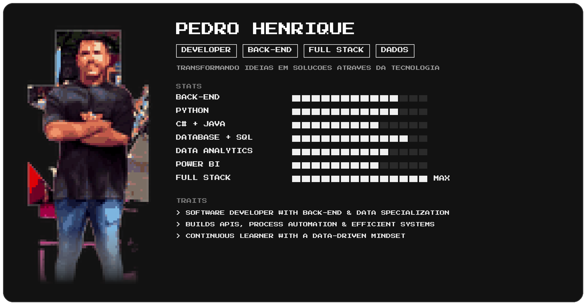
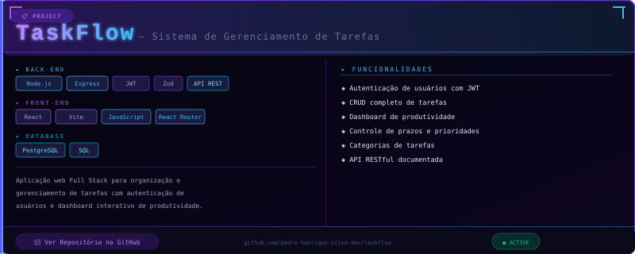
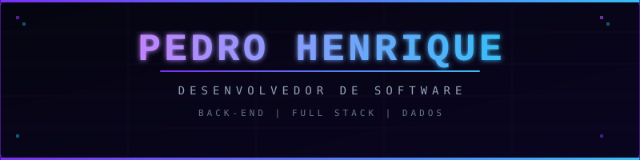

<div align="center">

<!-- ═══════════════════════════════════════════════════════════ -->
<!--           PIXEL ART PROFILE CARD — MAIN HEADER            -->
<!-- ═══════════════════════════════════════════════════════════ -->



<br/><br/>

<a href="https://linkedin.com/in/pedrohenriqueps-" target="_blank"></a>
&nbsp;&nbsp;
<a href="https://instagram.com/henriique.dev" target="_blank"></a>
&nbsp;&nbsp;
<a href="https://github.com/pedro-henrique-silva-dev" target="_blank"></a>
&nbsp;&nbsp;
<a href="mailto:henriique.dev7@gmail.com"></a>

</div>

<br/>

<!-- ═══════════════════════════════════════════════════════════ -->
<!--                      SOBRE MIM                            -->
<!-- ═══════════════════════════════════════════════════════════ -->

<div align="center">

## `< Sobre Mim />`

</div>

<div align="center">
<table>
<tr>
<td width="100%" style="border: none; padding: 0;">

```
  Sou profissional de TI com experiência em desenvolvimento back-end,
  front-end e arquitetura de dados.
  
  Tenho experiência prática na construção e integração de APIs,
  automação de processos em Python, gerenciamento de bancos de dados
  relacionais, análise de dados e criação de soluções voltadas à
  eficiência operacional.
  
  Tenho interesse em desenvolver sistemas, resolver problemas complexos
  e construir soluções tecnológicas eficientes.
```

</td>
</tr>
</table>
</div>

<div align="center">

| 🔭 Foco atual | Desenvolvimento Back-End e Full Stack |
|---|---|
| 💡 Interesse | APIs, Bancos de Dados, Automação, Data Analytics |
| 🚀 Objetivo | Vaga de Dev Back-End Jr, Full Stack Jr ou Analista de Dados |
| 🌍 Localização | Brasil 🇧🇷 |
| 📧 Contato | henriique.dev7@gmail.com |

</div>

<br/>

<!-- ═══════════════════════════════════════════════════════════ -->
<!--                    TECH STACK                              -->
<!-- ═══════════════════════════════════════════════════════════ -->

<div align="center">

## `< Tech Stack />`

</div>

---

### 🟣 Back-End

<div align="center">


</div>

---

### 🔵 Front-End

<div align="center">


</div>

---

### 🗄️ Database

<div align="center">


</div>

---

### 📊 Data Analytics & BI

<div align="center">


</div>

---

### 🛠️ Tools

<div align="center">


</div>

<br/>

<!-- ═══════════════════════════════════════════════════════════ -->
<!--                PROJETOS EM DESTAQUE                        -->
<!-- ═══════════════════════════════════════════════════════════ -->

<div align="center">

## `< Projetos em Destaque />`

</div>

---

### 🚀 TaskFlow — Sistema Full Stack de Gerenciamento de Tarefas

<div align="center">



</div>

<div align="center">

| | |
|:---:|---|
| **📌 Repositório** | [github.com/pedro-henrique-silva-dev/taskflow](https://github.com/pedro-henrique-silva-dev/taskflow) |
| **📋 Tipo** | Aplicação Web Full Stack |
| **🗃️ Status** | Ativo |

</div>

<details>
<summary><b>🔍 Ver detalhes do projeto</b></summary>

<br/>

**Descrição:**

Aplicação web desenvolvida para organização e gerenciamento de tarefas, com autenticação de usuários e dashboard interativo para acompanhamento de produtividade, prazos e prioridades.

**Back-End:**


**Front-End:**


**Banco de Dados:**


**Funcionalidades implementadas:**

- ✅ Autenticação e autorização de usuários com JWT
- ✅ CRUD completo de tarefas
- ✅ Dashboard de produtividade
- ✅ Controle de prazos e prioridades
- ✅ Categorização de tarefas
- ✅ API RESTful com validação via Zod

</details>

<br/>

<!-- ═══════════════════════════════════════════════════════════ -->
<!--                   GITHUB STATS                             -->
<!-- ═══════════════════════════════════════════════════════════ -->

<div align="center">

## `< GitHub Stats />`

</div>

<div align="center">


</div>

<div align="center">


</div>

<div align="center">


</div>

<br/>

<!-- ═══════════════════════════════════════════════════════════ -->
<!--                    CONTATO                                 -->
<!-- ═══════════════════════════════════════════════════════════ -->

<div align="center">

## `< Contato />`

</div>

<div align="center">

<a href="https://linkedin.com/in/pedrohenriqueps-" target="_blank"></a>
&nbsp;&nbsp;
<a href="https://instagram.com/henriique.dev" target="_blank"></a>
&nbsp;&nbsp;
<a href="https://github.com/pedro-henrique-silva-dev" target="_blank"></a>
&nbsp;&nbsp;
<a href="mailto:henriique.dev7@gmail.com"></a>

</div>

<br/>

---

<div align="center">



<br/>

<sub>
  Desenvolvido com 💜 por <strong>Pedro Henrique Pereira da Silva</strong><br/>
  <code>Back-End | Full Stack | Dados — Brasil 🇧🇷</code>
</sub>

</div>
